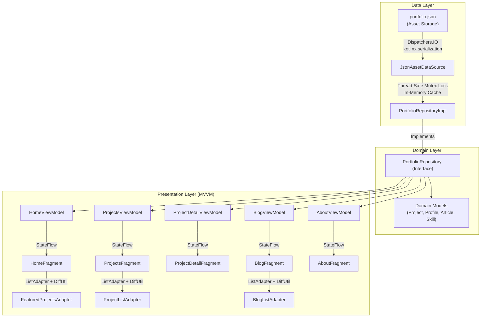

# Kirin — Technical Architecture & Evaluation Defense Guide

> **Candidate / Presenter:** Pranav Ray  
> **Registration Number:** 2427030289  
> **Application:** Kirin Native Android Telemetry & Systems Showcase  
> **Repository:** [github.com/pranav718/kirin](https://github.com/pranav718/kirin)  
> **Target SDK:** Android 15 (API 35 / 36) • **Min SDK:** Android 8.0 (API 26)  
> **Tech Stack:** Kotlin 2.0.21 • Material Design 3 XML • Single-Activity Architecture • MVVM • StateFlow • Coroutines • Navigation SafeArgs • Coil 2.7.0 • Chrome Custom Tabs

---

## 1. Executive Summary

**Kirin** is a native Android application built as a personal systems-engineering portfolio and telemetry client. It provides a real-time, offline-first interface for exploring 11 concurrent and distributed backend projects (such as `tunneru`, `hotaru`, and `tsuna`), technical publications on Medium, and developer credentials.

The app is built following **Google's Modern Android Architecture (MAD)** guidelines:
- **Clean Architecture & Separation of Concerns:** Strict layer decoupling across Data, Domain, and Presentation.
- **Single-Activity Architecture:** A single host `MainActivity` containing a `NavHostFragment` and dynamic bottom navigation bar.
- **Reactive State Flow:** Asynchronous data streaming powered by Kotlin Coroutines and `StateFlow`, collected with lifecycle awareness via `repeatOnLifecycle(STARTED)`.
- **Engineering-First Dark UI:** Bespoke Material Design 3 dark palette with true OLED black (`#0A0A0A`), layered dark surface elevation, brand gold accents (`#F4D03F`), and terminal-style developer badges.

---

## 2. End-to-End Architecture Sitemap

---

## 3. Screen Breakdown & Interactive Walkthrough

### 1. Home Dashboard (`HomeFragment`)
- **Profile Banner:** Author avatar, name, and systems-backend bio loaded with Coil and fallback placeholders.
- **Dynamic Metrics Dock:** 3 interactive counter cards (`11 PROJECTS`, `3 ARTICLES`, `31 SKILLS`) with touch-routing listeners that switch bottom navigation tabs.
- **Featured Systems Carousel:** Horizontal `RecyclerView` with `LinearLayoutManager.HORIZONTAL` rendering top distributed systems (`tunneru`, `hotaru`, `tsuna`).

### 2. Projects Catalog (`ProjectsFragment`)
- **Real-Time Search Bar:** Real-time multi-predicate text filter matching across `title`, `description`, and `techStack` tags with sub-millisecond dispatch.
- **Status Filter Chips:** Single-selection chip filters for `All (11)`, `Live Deployments (9)`, and `In Progress (2)`.
- **Empty State Feedback:** Dynamic empty state view displaying the active query with an instant "Reset Filters" action button.
- **Vertical Feed:** High-performance `RecyclerView` driven by `ProjectListAdapter` and `DiffUtil`.

### 3. Project Detail Screen (`ProjectDetailFragment`)
- **Architecture Overview:** Deep-dive technical breakdown of binary stream framing, P2P mesh topology, and zero-dependency Go engines.
- **Tech Stack Badges:** 6dp compact rounded developer badges displaying frameworks and protocols.
- **Action Dock:** 
  - `View Code on GitHub`: Implicit system intent to repository.
  - `Open Live Demo`: High-speed in-app **Chrome Custom Tab** without leaving the app.
  - `Share`: Android system share intent with pre-formatted project metadata.

### 4. Engineering Blog (`BlogFragment`)
- **Medium Publications Feed:** Technical articles on UDP hole punching, Raft consensus in Go, and Convex real-time synchronization.
- **Metadata Badges:** Date and Medium clap count tags with 1-tap Chrome Custom Tab reading.

### 5. Developer Profile & Credentials (`AboutFragment`)
- **Categorized Skills Matrix:** 31 categorized skills divided into Languages, Backend & Distributed, Databases & Caching, Frontend & Graphics, and Tools & DevOps.
- **Developer Platforms:** Clickable badges linking directly to GitHub, LinkedIn, X, LeetCode, Codeforces, and Chess.com.

---

## 4. Key Engineering Highlights for Viva Defense

### Q1: Why use `RecyclerView` with `ListAdapter` instead of legacy `ListView`?
- **View Recycling Pool:** When an item scrolls off-screen, its view container is recycled into a `RecycledViewPool` rather than being destroyed and recreated, eliminating memory allocation spikes.
- **Mandatory ViewHolder Pattern:** Enforced at the compiler level to eliminate repeated expensive `findViewById()` calls.
- **Eugene Myers' Diff Algorithm:** `ListAdapter` calculates list diffs asynchronously in the background (`AsyncListDiffer`) and only updates modified items, avoiding full-screen redraws (`notifyDataSetChanged`).

### Q2: Why is the app offline-first without SQLite / Room?
- For curated, read-only portfolio reference data (11 projects, 31 skills), spinning up an SQLite database adds unnecessary startup overhead and migrations.
- Kirin reads `portfolio.json` asynchronously using Kotlin Coroutines on `Dispatchers.IO`, parses with `kotlinx.serialization`, and caches the result in memory using a coroutine `Mutex`.
- Following the **Repository Pattern** ensures that if a REST API or Room database is added later, only a new data source implementation is required without altering the UI or ViewModels.

### Q3: How are Android 15 edge-to-edge system insets handled?
- Android 15 enforces edge-to-edge drawing by default.
- In `MainActivity`, `ViewCompat.setOnApplyWindowInsetsListener` applies top insets (`systemBars.top`) to the app bar and bottom insets (`systemBars.bottom`) directly as bottom padding to `BottomNavigationView`.
- This allows the dark surface background to extend behind the system gesture pill while keeping icons, active pills, and text labels completely visible and uncompressed.
